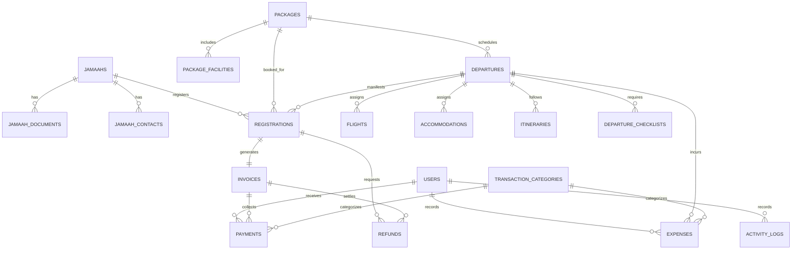

# AL GHIFARI HARAMAIN MANAGEMENT SYSTEM
**UMROH & HAJI SPECIALIST**

Sistem manajemen operasional terpadu tingkat enterprise untuk perusahaan Travel Haji dan Umrah **PT. Al Ghifari Haramain**. Aplikasi web full-stack ini dirancang khusus bagi pemilik (owner), direktur, tim finance, tim operasional, dan staf travel guna mengelola seluruh ekosistem perjalanan ibadah secara otomatis, akurat, aman, dan profesional.

---

## 🕌 1. Identitas Brand & Visual

- **Nama Aplikasi:** Al Ghifari Haramain Management System
- **Perusahaan:** Al Ghifari Haramain
- **Tagline:** UMROH & HAJI SPECIALIST
- **Arah Desain:** Premium Modern, Elegan, Nuansa Islami Minimalis (Forest Green, Emerald, & Royal Gold)
- **Logo Resmi:** Tersimpan pada `public/assets/brand/logo.png` (Logo resmi terproteksi tanpa distorsi)

### Palet Warna Resmi
| Nama Warna | Kode HEX | Peruntukan Desain |
|---|---|---|
| **Dark Forest Green** | `#073B2E` | Warna identitas utama, header, sidebar, navbar, border elegan |
| **Deep Emerald** | `#0B4939` | Gradien sekunder, hover state, card header |
| **Royal Gold** | `#C9A45B` | Aksen emas premium, tombol konfirmasi, badge unggulan, garis pemisah |
| **Light Gold** | `#E5CF96` | Border aksen, ornamen halus, highlight status |
| **Obsidian Black** | `#080B09` | Elemen teks kontras tinggi, background aksen malam |
| **Warm Ivory** | `#F5F0E5` | Latar terang bernuansa timur tengah, card soft background |
| **White** | `#FFFFFF` | Latar konten utama, readability teks optimal |

---

## 🛠️ 2. Tech Stack & Dependencies

- **Backend:** PHP 8.2+ (XAMPP / Standalone), Laravel 12.x MVC
- **Database:** MySQL 8.0+ / MariaDB (`al_ghifari_haramain_db`)
- **Frontend:** Blade Templating, Bootstrap 5.3, Bootstrap Icons, Sass, Vite 7.x, Chart.js
- **Autentikasi & RBAC:** Session-based auth dengan Spatie Laravel Permission
- **Ekspor Dokumen:** Barryvdh DomPDF (A4 Landscape & A5 Landscape), Maatwebsite Laravel Excel
- **Komunikasi:** WhatsApp Business Cloud API Resmi (dengan Fallback Simulation Mode otomatis)
- **Testing:** PHPUnit / Laravel Feature Test Suite (24 Test Cases, 77 Assertions, 100% Pass)

---

## 👥 3. Kredensial Akun Pengujian Internal

Aplikasi ini bersifat sistem internal travel (*strictly no public guest registration*). Kredensial default berikut telah disiapkan oleh database seeder:

| Role | Email | Password | Hak Akses Utama |
|---|---|---|---|
| **Super Admin** | `superadmin@alghifari.com` | `password` | Akses penuh seluruh sistem, audit log, manajemen user & peran |
| **Admin** | `admin@alghifari.com` | `password` | Operasional jamaah, paket perjalanan, keberangkatan, komunikasi WA |
| **Finance** | `finance@alghifari.com` | `password` | Invoice, pencatatan pembayaran DP/pelunasan, pengeluaran, kwitansi, refund |
| **Manager** | `manager@alghifari.com` | `password` | Executive dashboard, laporan laba/rugi, realisasi kuota, audit trail |
| **Staff** | `staff@alghifari.com` | `password` | Pendaftaran jamaah baru, checklist kesiapan keberangkatan, verifikasi berkas |

---

## 📦 4. Arsitektur 10 Modul Terintegrasi

### 1. Dashboard Eksekutif (`/dashboard`)
- Statistik real-time jamaah aktif, jemaah Haji, jemaah Umrah, total paket, dan jadwal rombongan.
- Grafik tren penerimaan kas pembayaran dan pendaftaran jamaah bulanan menggunakan Chart.js.
- Peringatan dokumen belum lengkap (paspor < 7 bulan masa berlaku) dan tagihan mendekati jatuh tempo.
- Filter data operasional harian, bulanan, tahunan, atau rentang tanggal kustom.

### 2. Manajemen Jamaah & Berkas Digital (`/jamaah`)
- Master data jamaah: NIK (16 digit), No. KK, No. Paspor, Masa Berlaku Paspor, Tempat & Tgl Lahir, Jenis Kelamin, Kontak Keluarga Darurat, Catatan Khusus Kursi Roda/Kesehatan.
- Upload dan verifikasi berkas digital (KTP, KK, Paspor Asli, Pas Foto 4x6 Background Putih).
- Riwayat pendaftaran program haji & umrah per jamaah.
- Cetak formulir pendaftaran resmi (PDF) & Ekspor Master Data (Excel/PDF).

### 3. Paket Haji & Umrah (`/packages`)
- Pengaturan paket Haji Reguler/Khusus/Furoda dan Umrah Reguler/VIP/Ramadhan.
- Struktur harga kamar bertingkat: *Quad* (sekamar ber-4), *Triple* (ber-3), *Double* (ber-2).
- Maskapai penerbangan, hotel Makkah & Madinah (bintang 3/4/5), durasi perjalanan (hari).
- Fasilitas inklusif & eksklusif (tiket PP, visa, handling bandara, makan fullboard, manasik, perlengkapan).

### 4. Jadwal Keberangkatan & Manifest Rombongan (`/departures`)
- Penjadwalan kloter rombongan, kode grup unik, kuota seat, dan persentase okupansi.
- Manifest Penumpang Resmi Al Ghifari (A4 Landscape PDF dengan kop surat dan logo resmi).
- Rincian penerbangan pergi/pulang (maskapai, kode PNR, nomor flight, jam keberangkatan & ketibaan).
- Hotel akomodasi Makkah & Madinah dengan tanggal check-in & check-out.
- Itinerary perjalanan harian lengkap dengan agenda manasik, ziarah, dan waktu Raudhah.
- Checklist kesiapan operasional interaktif (Verifikasi Paspor, Visa Elektronik, Tasreeh, Bus Saudi, Seragam Batik & Koper).

### 5. Keuangan, Tagihan, Kwitansi & Invoicing (`/finance`)
- Penerbitan Invoice otomatis dengan nomor unik format `INV-YYYYMM-XXXX`.
- Pencatatan pembayaran: Uang Muka (DP), Cicilan / Angsuran, dan Pelunasan.
- Rekalkulasi otomatis: `Sisa Tagihan = Total Tagihan - Total Pembayaran Valid`.
- Cetak Kwitansi Resmi Pembayaran (A5 Landscape PDF dengan terbilang rupiah, kop resmi, dan otorisasi kasir).
- Pencatatan Beban Pengeluaran Operasional (tiket, visa, hotel, bus, muthawif) dengan alokasi kloter.
- Manajemen Pengembalian Dana (Refund) pembatalan paket dengan audit log ketat.
- Pembatalan transaksi aman (*reversal*) yang mengembalikan saldo piutang tanpa menghapus jejak audit.

### 6. Pusat Laporan & Analitik Keuangan (`/reports`)
- **Laporan Kas Masuk:** Rekapitulasi pembayaran jamaah per periode dengan filter metode (Transfer/Tunai) dan export PDF.
- **Laporan Tunggakan & Piutang:** Daftar jamaah belum lunas lengkap dengan kontak WhatsApp untuk penagihan.
- **Laporan Laba Rugi Operasional:** Rekapitulasi pendapatan vs beban pengeluaran per kategori beserta laba bersih.
- **Laporan Keberangkatan:** Rekapitulasi okupansi kursi, kapasitas, dan status rombongan tahunan.

### 7. Manajemen Pengguna & Hak Akses RBAC (`/users`, `/roles`)
- Pengelolaan akun pengguna internal dan aktivasi/deaktivasi akun (*toggle status*).
- Matriks izin akses granular (*Role-Permission Matrix*) menggunakan Spatie Laravel Permission.
- Proteksi mutlak: Pencegahan penghapusan akun diri sendiri atau penonaktifan Super Admin terakhir.

### 8. Integrasi WhatsApp Business Cloud API (`/whatsapp`)
- Layanan modular `WhatsAppService` yang mendukung pengiriman pesan manual dan berbasis template.
- Variabel dinamis otomatis: `{nama}`, `{sisa_tagihan}`, `{daftar_dokumen}`, `{tanggal_berangkat}`, `{maskapai_flight}`, `{tour_leader}`.
- **Mode Simulasi Aman (Zero Dependency API Key):** Apabila credential Meta belum diatur di `.env`, sistem otomatis mengaktifkan mode simulasi yang mencatat riwayat pesan di database tanpa memicu error API.
- Template manajemen untuk reminder pelunasan H-14, pengingat dokumen, dan briefing manasik.

### 9. Notifikasi & Audit Log Sistem (`/notifications`, `/audit-logs`)
- Peringatan otomatis jatuh tempo tagihan, paspor kadaluwarsa, dan status keberangkatan rombongan.
- Audit Log komprehensif mencatat pengguna, modul, aksi, IP address, user agent, dan waktu eksekusi.
- Tampilan JSON Diff detail untuk data sebelum (*old values*) dan sesudah (*new values*) perubahan.
- Sanitasi privasi otomatis: penyembunyian password, token, dan penyamaran nomor NIK.

### 10. Pengaturan Aplikasi & Rekening Bank (`/settings`)
- Profil perusahaan: Nama resmi, tagline brand, email, telepon, WhatsApp CS, alamat, dan website.
- Konfigurasi format penomoran dokumen otomatis (`registration_prefix`, `invoice_prefix`, `receipt_prefix`).
- Master data rekening bank resmi travel (BSI, Mandiri, BCA) yang ditampilkan pada invoice jamaah.

---

## 🗄️ 5. Desain Database & Skema Relasi

Database `al_ghifari_haramain_db` dirancang dengan integritas relasional tinggi:



---

## 🚀 6. Panduan Instalasi & Menjalankan di Lokal

### Langkah 1: Persiapan Environment
1. Pastikan **XAMPP** aktif (Apache & MySQL pada port 3306).
2. Buat database baru bernama `al_ghifari_haramain_db` melalui phpMyAdmin atau terminal:
   ```sql
   CREATE DATABASE IF NOT EXISTS al_ghifari_haramain_db CHARACTER SET utf8mb4 COLLATE utf8mb4_unicode_ci;
   ```

### Langkah 2: Konfigurasi File `.env`
Pastikan konfigurasi database di file `.env` mengarah ke database lokal Anda:
```env
APP_NAME="Al Ghifari Haramain Management System"
APP_ENV=local
APP_KEY=base64:...
APP_DEBUG=true
APP_TIMEZONE=Asia/Jakarta
APP_URL=http://localhost:8000

DB_CONNECTION=mysql
DB_HOST=127.0.0.1
DB_PORT=3306
DB_DATABASE=al_ghifari_haramain_db
DB_USERNAME=root
DB_PASSWORD=

# WhatsApp Business Cloud API (Opsional - Jika kosong, otomatis Simulation Mode)
WHATSAPP_TOKEN=
WHATSAPP_PHONE_NUMBER_ID=
WHATSAPP_BUSINESS_ACCOUNT_ID=
```

### Langkah 3: Migrasi Database & Seeding Data Awal
Jalankan migrasi tabel dan seeding data role, akun demo, pengaturan, dan paket:
```bash
php artisan migrate
php artisan db:seed
```

### Langkah 4: Kompilasi Aset Frontend
```bash
npm install
npm run build
```

### Langkah 5: Menjalankan Aplikasi
```bash
php artisan serve
```
Buka browser dan akses aplikasi di: **`http://localhost:8000`**

Login menggunakan salah satu akun pengujian (misal: `superadmin@alghifari.com` / `password`).

---

## 🧪 7. Hasil Pengujian Otomatis (Quality Assurance)

Seluruh pengujian unit dan integrasi dijalankan menggunakan PHPUnit dan terbukti **100% Lulus**:

```bash
php artisan test
```

### Output Pengujian:
```text
   PASS  Tests\Unit\ExampleTest
  ✓ that true is true

   PASS  Tests\Feature\AuthTest
  ✓ guest is redirected to login when accessing dashboard
  ✓ login screen can be rendered
  ✓ user can authenticate using valid credentials
  ✓ user cannot authenticate with invalid password
  ✓ user can logout

   PASS  Tests\Feature\ExampleTest
  ✓ the application returns a successful response

   PASS  Tests\Feature\FinanceTest
  ✓ authenticated user can view finance summary
  ✓ authenticated user can view invoices
  ✓ recording payment updates invoice balance

   PASS  Tests\Feature\InitializationTest
  ✓ welcome page redirects and displays brand identity
  ✓ mysql database connection is operational
  ✓ brand logo exists

   PASS  Tests\Feature\JamaahTest
  ✓ authenticated user can view jamaah index
  ✓ authenticated user can create jamaah
  ✓ authenticated user can view jamaah profile

   PASS  Tests\Feature\ModuleIntegrationTest
  ✓ packages index and detail can be viewed
  ✓ departure manifest and calendar can be viewed
  ✓ departure checklist can be updated
  ✓ reports can be rendered and exported as pdf
  ✓ settings and audit logs can be viewed
  ✓ notifications can be marked as read

   PASS  Tests\Feature\WhatsAppTest
  ✓ whatsapp service simulation mode records message
  ✓ authenticated user can view whatsapp center

  Tests:    24 passed (77 assertions)
  Duration: 4.00s
```

---

## 🔒 8. Fitur yang Membutuhkan Kredensial Eksternal

| Fitur | Vendor Eksternal | Status Saat Ini | Keterangan |
|---|---|---|---|
| **WhatsApp Live Messaging** | Meta WhatsApp Business Cloud API | **Mode Simulasi Aktif** | Seluruh UI, controller, logging, dan antrean pesan sudah 100% siap. Pesan saat ini dicatat sebagai `simulated`. Cukup isi `WHATSAPP_TOKEN` dan `WHATSAPP_PHONE_NUMBER_ID` di `.env` saat token Meta Cloud API resmi tersedia untuk beralih otomatis ke *live messaging*. |
| **Penyimpanan Berkas Digital** | Local Storage (`storage/app/public`) | **Aktif** | Berkas KTP, Paspor, dan bukti transfer tersimpan lokal. Siap dialihkan ke AWS S3 jika diperlukan produksi multi-server. |

---

## 📄 Hak Cipta & Lisensi
Hak Cipta &copy; 2026 **PT. Al Ghifari Haramain** — *UMROH & HAJI SPECIALIST*. Seluruh hak cipta dilindungi undang-undang.
