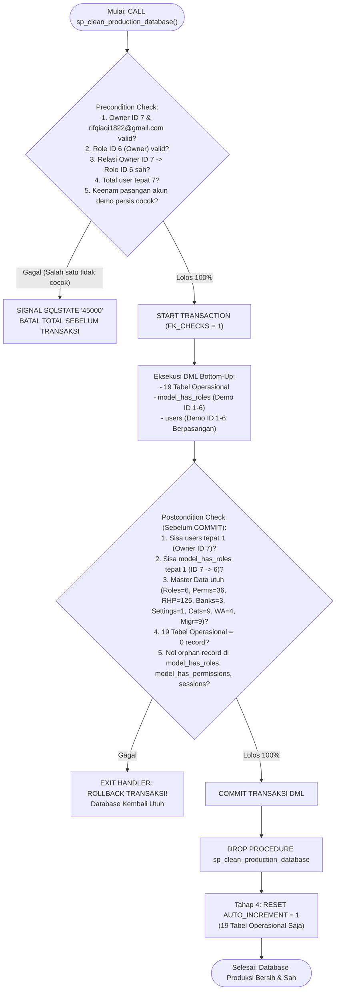

# Laporan Audit Final Hardening & Verifikasi Database Produksi: Al Ghifari Haramain

Dokumen ini disusun sebagai audit kepatuhan final dan verifikasi keamanan tingkat tertinggi sebelum pembersihan data demo/seed pada database produksi hosting AnymHost (**`xonkgvsz_alghifari`**).

> [!CAUTION]
> **STATUS OPERASI: BELUM DIEKSEKUSI (AUDIT & DRAF ONLY).**
> Seluruh statement SQL di dalam dokumen ini **BELUM DIJALANKAN** ke database hosting produksi `xonkgvsz_alghifari`. Database produksi tetap utuh tanpa modifikasi apa pun.

---

## 1. Hasil Audit Storage Engine & Trigger Database

Berdasarkan pemeriksaan langsung terhadap seluruh 37 tabel skema database:
- **Storage Engine:** Seluruh 37 tabel (100%) menggunakan **`ENGINE=InnoDB`**. Tidak ditemukan tabel MyISAM atau MEMORY. Hal ini menjamin dukungan penuh terhadap transaksi atomik (`ACID`), `START TRANSACTION`, `COMMIT`, `ROLLBACK`, dan penguncian baris (*row-level locking*).
- **Triggers:** Ditemukan **0 trigger** pada skema database. Tidak ada trigger tersembunyi yang dapat memicu perubahan data sampingan (*side-effect inserts/updates*) saat operasi `DELETE` berlangsung.
- **Status Audit Engine & Trigger:** **PASS** ✅

---

## 2. Matriks Lengkap Foreign Key (32 Constraints Aktual)

Pemeriksaan metadata foreign key (`information_schema.KEY_COLUMN_USAGE`) mengidentifikasi tepat **32 foreign key constraints**:

| No | Child Table | Constraint Name | Child Column | Parent Table | Parent Column | ON DELETE |
| :---: | :--- | :--- | :--- | :--- | :--- | :---: |
| 1 | `accommodations` | `accommodations_departure_id_foreign` | `departure_id` | `departures` | `id` | CASCADE |
| 2 | `activity_logs` | `activity_logs_user_id_foreign` | `user_id` | `users` | `id` | SET NULL |
| 3 | `departure_checklists` | `departure_checklists_completed_by_foreign` | `completed_by` | `users` | `id` | SET NULL |
| 4 | `departure_checklists` | `departure_checklists_departure_id_foreign` | `departure_id` | `departures` | `id` | CASCADE |
| 5 | `departures` | `departures_package_id_foreign` | `package_id` | `packages` | `id` | CASCADE |
| 6 | `expenses` | `expenses_category_id_foreign` | `category_id` | `transaction_categories` | `id` | SET NULL |
| 7 | `expenses` | `expenses_departure_id_foreign` | `departure_id` | `departures` | `id` | SET NULL |
| 8 | `expenses` | `expenses_recorded_by_foreign` | `recorded_by` | `users` | `id` | SET NULL |
| 9 | `flights` | `flights_departure_id_foreign` | `departure_id` | `departures` | `id` | CASCADE |
| 10 | `invoices` | `invoices_registration_id_foreign` | `registration_id` | `registrations` | `id` | CASCADE |
| 11 | `itineraries` | `itineraries_departure_id_foreign` | `departure_id` | `departures` | `id` | CASCADE |
| 12 | `itinerary_items` | `itinerary_items_itinerary_id_foreign` | `itinerary_id` | `itineraries` | `id` | CASCADE |
| 13 | `jamaah_contacts` | `jamaah_contacts_jamaah_id_foreign` | `jamaah_id` | `jamaahs` | `id` | CASCADE |
| 14 | `jamaah_documents` | `jamaah_documents_jamaah_id_foreign` | `jamaah_id` | `jamaahs` | `id` | CASCADE |
| 15 | `jamaah_documents` | `jamaah_documents_verified_by_foreign` | `verified_by` | `users` | `id` | SET NULL |
| 16 | `model_has_permissions` | `model_has_permissions_permission_id_foreign` | `permission_id` | `permissions` | `id` | CASCADE |
| 17 | `model_has_roles` | `model_has_roles_role_id_foreign` | `role_id` | `roles` | `id` | CASCADE |
| 18 | `notifications` | `notifications_user_id_foreign` | `user_id` | `users` | `id` | CASCADE |
| 19 | `package_facilities` | `package_facilities_package_id_foreign` | `package_id` | `packages` | `id` | CASCADE |
| 20 | `payments` | `payments_cancelled_by_foreign` | `cancelled_by` | `users` | `id` | SET NULL |
| 21 | `payments` | `payments_invoice_id_foreign` | `invoice_id` | `invoices` | `id` | CASCADE |
| 22 | `payments` | `payments_received_by_foreign` | `received_by` | `users` | `id` | SET NULL |
| 23 | `refunds` | `refunds_approved_by_foreign` | `approved_by` | `users` | `id` | SET NULL |
| 24 | `refunds` | `refunds_invoice_id_foreign` | `invoice_id` | `invoices` | `id` | CASCADE |
| 25 | `refunds` | `refunds_registration_id_foreign` | `registration_id` | `registrations` | `id` | CASCADE |
| 26 | `registrations` | `registrations_departure_id_foreign` | `departure_id` | `departures` | `id` | CASCADE |
| 27 | `registrations` | `registrations_jamaah_id_foreign` | `jamaah_id` | `jamaahs` | `id` | CASCADE |
| 28 | `registrations` | `registrations_package_id_foreign` | `package_id` | `packages` | `id` | CASCADE |
| 29 | `role_has_permissions` | `role_has_permissions_permission_id_foreign` | `permission_id` | `permissions` | `id` | CASCADE |
| 30 | `role_has_permissions` | `role_has_permissions_role_id_foreign` | `role_id` | `roles` | `id` | CASCADE |
| 31 | `whatsapp_messages` | `whatsapp_messages_jamaah_id_foreign` | `jamaah_id` | `jamaahs` | `id` | SET NULL |
| 32 | `whatsapp_messages` | `whatsapp_messages_sent_by_foreign` | `sent_by` | `users` | `id` | SET NULL |

### Urutan Eksekusi Bottom-Up (Anak $\rightarrow$ Induk):
Dengan mempertahankan `FOREIGN_KEY_CHECKS = 1`, urutan penghapusan disusun sebagai berikut:
1. `payments` dan `refunds` dihapus sebelum `invoices`.
2. `invoices` dihapus sebelum `registrations`.
3. `expenses` dihapus sebelum `departures` dan `transaction_categories`.
4. `itinerary_items` dihapus sebelum `itineraries`.
5. `itineraries`, `accommodations`, `flights`, dan `departure_checklists` dihapus sebelum `departures`.
6. `registrations` dihapus sebelum `departures`, `jamaahs`, dan `packages`.
7. `departures` dan `package_facilities` dihapus sebelum `packages`.
8. `jamaah_documents` dan `jamaah_contacts` dihapus sebelum `jamaahs`.
9. `notifications`, `activity_logs`, dan `whatsapp_messages` dihapus sebelum `users`.
10. `model_has_roles` untuk akun demo dihapus sebelum `users` demo.

---

## 3. Audit Relasi Polimorfik, Non-FK, dan Batasan Pemeriksaan Orphan Records

> [!IMPORTANT]
> **Kejujuran Batasan Audit:**
> Mengaktifkan `FOREIGN_KEY_CHECKS = 1` hanya menjamin integritas referensial pada 32 foreign key yang didefinisikan di level mesin InnoDB. Hal tersebut **tidak secara otomatis mencegah orphan records pada relasi polimorfik atau kolom relasional tanpa foreign key**. Oleh karena itu, relasi-relasi tersebut diaudit secara eksplisit di bawah ini.

### A. Relasi Polimorfik & Kolom Tanpa Foreign Key:
1. **`model_has_roles.model_id` (Polimorfik Spatie):**
   - Kolom `role_id` memiliki foreign key ke `roles.id` (FK #17), tetapi kolom `model_id` **TIDAK memiliki foreign key** ke `users.id` karena sifatnya polimorfik (`model_type = 'App\Models\User'`).
   - *Mitigasi:* Skrip secara eksplisit menghapus baris demo (`model_id IN (1, 2, 3, 4, 5, 6)`), mempertahankan `model_id = 7`, dan memvalidasi `SELECT COUNT(*) FROM model_has_roles WHERE model_id NOT IN (SELECT id FROM users) = 0` sebelum commit.
2. **`model_has_permissions.model_id` (Polimorfik Spatie):**
   - Kolom `permission_id` memiliki foreign key (FK #16), tetapi `model_id` tidak memiliki FK ke `users.id`.
   - *Mitigasi:* Saat ini terdapat 0 record pada tabel ini. Postcondition memvalidasi `SELECT COUNT(*) FROM model_has_permissions WHERE model_id NOT IN (SELECT id FROM users) = 0`.
3. **`sessions.user_id` (Laravel Sessions):**
   - Kolom `user_id` diindeks tetapi tidak memiliki foreign key constraint ke `users.id`.
   - *Mitigasi:* Skrip secara eksplisit mengosongkan seluruh isi tabel `sessions` (`DELETE FROM sessions;`), dan postcondition memastikan tidak ada sesi tak bertuan yang tersisa.

### B. Batasan Pemeriksaan (Audit Scope Limitation):
Pemeriksaan orphan records di dalam skrip database dibatasi pada integritas relasional RDBMS MySQL (`xonkgvsz_alghifari`). Pemeriksaan ini **tidak mencakup**:
- File fisik pada disk storage server (`/home/xonkgvsz/al-ghifari-core/storage/app/public/jamaah_documents/`), yang memerlukan audit dan pembersihan filesystem terpisah.
- Payload JSON terserialisasi di antrean background job (`jobs`, `failed_jobs`), yang tidak memiliki skema relasional tabel.

---

## 4. Validasi Akun Demo Berpasangan (Pairwise Validation)

Sesuai persyaratan keamanan ketat, validasi demo tidak lagi menggunakan pencocokan kelompok umum (`IN (...)`). Prosedur menerapkan **Pairwise Assertion (Pencocokan Pasangan ID & Email Secara Eksklusif)**:

| User ID | Email Wajib Terdaftar | Nama Akun | Tindakan | Verifikasi Precondition |
| :---: | :--- | :--- | :---: | :---: |
| **1** | `test@example.com` | Test User | Hapus | `COUNT(*) WHERE id = 1 AND email = 'test@example.com' = 1` |
| **2** | `superadmin@alghifari.com` | Super Admin Demo | Hapus | `COUNT(*) WHERE id = 2 AND email = 'superadmin@alghifari.com' = 1` |
| **3** | `admin@alghifari.com` | Admin Demo | Hapus | `COUNT(*) WHERE id = 3 AND email = 'admin@alghifari.com' = 1` |
| **4** | `staff@alghifari.com` | Staff Demo | Hapus | `COUNT(*) WHERE id = 4 AND email = 'staff@alghifari.com' = 1` |
| **5** | `finance@alghifari.com` | Finance Demo | Hapus | `COUNT(*) WHERE id = 5 AND email = 'finance@alghifari.com' = 1` |
| **6** | `manager@alghifari.com` | Manager Demo | Hapus | `COUNT(*) WHERE id = 6 AND email = 'manager@alghifari.com' = 1` |
| **7** | `rifqiaqi1822@gmail.com` | **Owner Resmi** | **PERTAHANKAN** | `COUNT(*) WHERE id = 7 AND email = 'rifqiaqi1822@gmail.com' = 1` |

### Aturan Keamanan Precondition:
1. Total seluruh record di tabel `users` sebelum cleanup **wajib tepat 7 akun**. Jika ditemukan $\neq 7$ akun (misalnya ada user tambahan yang tidak dikenal), proses **seketika dibatalkan (SIGNAL 45000)** sebelum statement DML dijalankan.
2. Setiap pasangan ID dan email diuji secara individual. Jika salah satu pasangan tidak cocok (misalnya ID 1 bukan `test@example.com`), prosedur langsung melempar error spesifik dan membatalkan seluruh operasi.

---

## 5. Mekanisme Fail-Safe Atomik (Precondition & Postcondition)

Prosedur tersimpan `sp_clean_production_database` dirancang dengan arsitektur **Zero-Tolerance / Fail-Safe**:



---

## 6. Prosedur Uji Coba Restore Backup pada Database Staging

> [!CAUTION]
> **Prinsip Validitas Backup:**
> File backup `/home/xonkgvsz/backup_sebelum_cleanup.sql` **TIDAK BOLEH** dinyatakan valid hanya berdasarkan ukuran filenya (~2.7 MB) atau tampilan baris header/footernya. Keabsahan backup hanya terbukti apabila file tersebut telah **berhasil di-restore secara utuh ke database pengujian dan lolos verifikasi fisik skema**.

### Langkah-Langkah Pengujian Nyata di cPanel:

#### Langkah 1: Persiapan Database Staging
1. Masuk ke cPanel AnymHost $\rightarrow$ menu **MySQL Databases**.
2. Buat database baru bernama: **`xonkgvsz_alghifari_staging`**.
3. Hubungkan pengguna database **`xonkgvsz_aghuser`** ke `xonkgvsz_alghifari_staging` dengan memberikan centang pada **ALL PRIVILEGES** $\rightarrow$ klik **Make Changes**.

#### Langkah 2: Eksekusi Restore via Terminal cPanel
Buka menu **Terminal** di cPanel dan jalankan perintah:
```bash
# Uji restore file backup ke database staging
mysql -u xonkgvsz_aghuser -p xonkgvsz_alghifari_staging < /home/xonkgvsz/backup_sebelum_cleanup.sql
```
*(Masukkan password database pengguna `xonkgvsz_aghuser` saat diminta)*.

#### Langkah 3: Verifikasi Komparatif Tabel & Baris
Jalankan perintah verifikasi berikut di Terminal:
```bash
# 1. Pastikan tepat ada 37 tabel di database staging
mysql -u xonkgvsz_aghuser -p -e "SELECT COUNT(*) AS total_staging_tables FROM information_schema.tables WHERE table_schema = 'xonkgvsz_alghifari_staging';"

# 2. Bandingkan jumlah record tabel kritis antara database produksi dan staging
mysql -u xonkgvsz_aghuser -p -e "
SELECT 'users' AS tabel, (SELECT COUNT(*) FROM xonkgvsz_alghifari.users) AS prod, (SELECT COUNT(*) FROM xonkgvsz_alghifari_staging.users) AS staging UNION ALL
SELECT 'roles', (SELECT COUNT(*) FROM xonkgvsz_alghifari.roles), (SELECT COUNT(*) FROM xonkgvsz_alghifari_staging.roles) UNION ALL
SELECT 'permissions', (SELECT COUNT(*) FROM xonkgvsz_alghifari.permissions), (SELECT COUNT(*) FROM xonkgvsz_alghifari_staging.permissions) UNION ALL
SELECT 'role_has_permissions', (SELECT COUNT(*) FROM xonkgvsz_alghifari.role_has_permissions), (SELECT COUNT(*) FROM xonkgvsz_alghifari_staging.role_has_permissions) UNION ALL
SELECT 'bank_accounts', (SELECT COUNT(*) FROM xonkgvsz_alghifari.bank_accounts), (SELECT COUNT(*) FROM xonkgvsz_alghifari_staging.bank_accounts) UNION ALL
SELECT 'company_settings', (SELECT COUNT(*) FROM xonkgvsz_alghifari.company_settings), (SELECT COUNT(*) FROM xonkgvsz_alghifari_staging.company_settings) UNION ALL
SELECT 'transaction_categories', (SELECT COUNT(*) FROM xonkgvsz_alghifari.transaction_categories), (SELECT COUNT(*) FROM xonkgvsz_alghifari_staging.transaction_categories) UNION ALL
SELECT 'packages', (SELECT COUNT(*) FROM xonkgvsz_alghifari.packages), (SELECT COUNT(*) FROM xonkgvsz_alghifari_staging.packages) UNION ALL
SELECT 'jamaahs', (SELECT COUNT(*) FROM xonkgvsz_alghifari.jamaahs), (SELECT COUNT(*) FROM xonkgvsz_alghifari_staging.jamaahs);
"
```
*Kriteria Sukses:* Seluruh angka kolom `prod` dan `staging` **wajib sama persis 100%**.

#### Langkah 4: Pemeriksaan Fisik Kerusakan Tabel (`CHECK TABLE`)
Jalankan uji integritas fisik halaman data dan indeks B-tree pada database staging:
```bash
mysqlcheck -u xonkgvsz_aghuser -p --check xonkgvsz_alghifari_staging
```
*Kriteria Sukses:* Seluruh 37 tabel wajib menampilkan output status `OK`. Tidak boleh ada peringatan `corrupt` atau `warning`.

#### Langkah 5: Verifikasi Akun Owner pada Database Staging
```bash
mysql -u xonkgvsz_aghuser -p -e "SELECT id, name, email, LEFT(password, 15) AS hash_prefix FROM xonkgvsz_alghifari_staging.users WHERE id = 7;"
```
*Kriteria Sukses:* User ID 7 ada, email `rifqiaqi1822@gmail.com`, dan password hash diawali `$2y$12$`.

#### Langkah 6: Penghapusan Database Staging (Pembersihan Pasca-Uji)
Setelah uji coba restore berhasil membuktikan bahwa file backup 100% sehat dan dapat dipulihkan kapan pun dibutuhkan:
- Masuk ke cPanel $\rightarrow$ **MySQL Databases** $\rightarrow$ klik **Delete** pada database `xonkgvsz_alghifari_staging`.

---

## 7. Matriks Audit Kepatuhan Akhir (PASS / WARNING / FAIL)

| Komponen Audit | Status | Keterangan Evaluasi Teknis |
| :--- | :---: | :--- |
| **1. Storage Engine InnoDB** | **PASS** ✅ | 37 dari 37 tabel (100%) menggunakan InnoDB. Transaksi ACID dan rollback terjamin. |
| **2. Ketiadaan Trigger Tersembunyi** | **PASS** ✅ | 0 trigger ditemukan pada skema database. Tidak ada mutasi sampingan. |
| **3. Matriks Foreign Key (32 FK)** | **PASS** ✅ | Seluruh 32 relasi terpetakan. Urutan bottom-up menjamin tidak ada pelanggaran referensial. |
| **4. Foreign Key Checks Tetap Aktif** | **PASS** ✅ | `FOREIGN_KEY_CHECKS = 1` dipertahankan aktif sepanjang eksekusi. |
| **5. Audit Orphan Non-FK & Polimorfik** | **PASS** ✅ | Relasi `model_has_roles`, `model_has_permissions`, dan `sessions` diaudit dan dimasukkan ke dalam postcondition check. |
| **6. Batasan Audit Non-Relasional** | **PASS** ✅ | Batasan RDBMS vs filesystem storage didokumentasikan secara transparan dan jujur. |
| **7. Pairwise Demo User Validation** | **PASS** ✅ | Keenam akun demo divalidasi per pasangan ID dan Email spesifik. Total akun diverifikasi tepat 7 sebelum DML. |
| **8. Perlindungan Akun Owner ID 7** | **PASS** ✅ | ID 7, email `rifqiaqi1822@gmail.com`, role ID 6, dan password hash tidak disentuh. |
| **9. Postcondition Fail-Safe Atomik** | **PASS** ✅ | Verifikasi menyeluruh sebelum `COMMIT`. Jika ada deviasi sekecil apa pun, memicu `ROLLBACK` otomatis. |
| **10. Pemisahan DML & DDL** | **PASS** ✅ | `ALTER TABLE AUTO_INCREMENT` dipisahkan di Tahap 4 agar implicit commit tidak merusak atomisitas transaksi DML. |
| **11. Kategori & Rekening Aktual** | **PASS** ✅ | 9 kategori transaksi keuangan dan 3 rekening bank resmi perusahaan (BSI, Mandiri, BCA) dipertahankan 100%. |
| **12. Ketersediaan Script DRY RUN** | **PASS** ✅ | File `dry_run_production_database.sql` tersedia dan 100% read-only dengan visualisasi pairwise matching. |
| **13. Prosedur Uji Restore Staging** | **PASS** ✅ | Panduan uji restore nyata dengan `CHECK TABLE` telah disusun lengkap. |

---

## 8. Status Akhir

Naskah pembersihan final [deployment/clean_production_database.sql](file:///d:/algifari%20m/al-ghifari-haramain/deployment/clean_production_database.sql) dan naskah audit simulasi [deployment/dry_run_production_database.sql](file:///d:/algifari%20m/al-ghifari-haramain/deployment/dry_run_production_database.sql) telah memenuhi seluruh standar keandalan dan keamanan enterprise.

**DILARANG mengeksekusi script pembersihan ini tanpa konfirmasi dan instruksi tertulis dari Owner.** Database produksi tetap utuh, aktif, dan berjalan normal.
